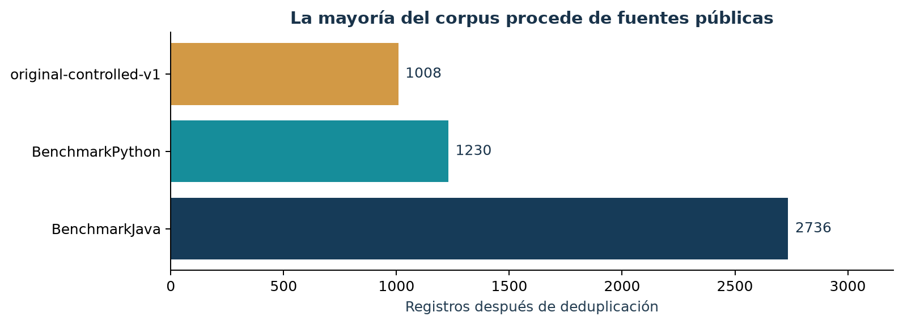
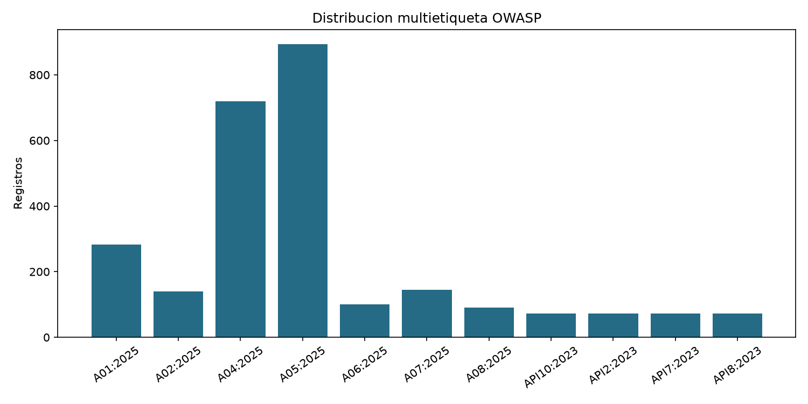
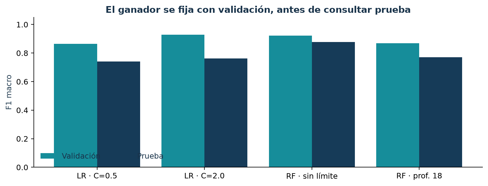
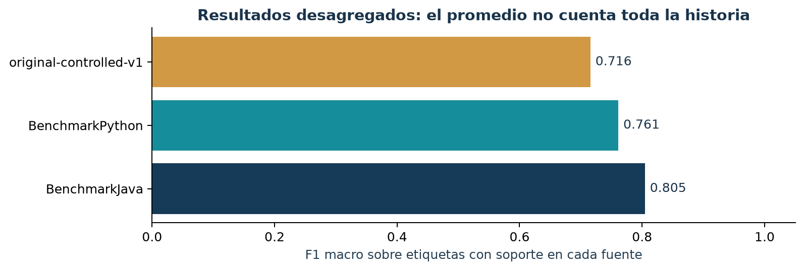

# VulnMiner · Informe técnico

Autor: DavidPilaguano. ESPE. 24 de noviembre de 2026.

ESPE / DESARROLLO DE SOFTWARE SEGURO

SEMMA · OWASP Top 10:2025 · OWASP API Security Top 10:2023

4.974 registros preparados; 2 fuentes públicas descargadas; 0.7618 F1 macro · modelo híbrido

DavidPilaguano

Informe técnico / Edición con datos públicos / 24 de noviembre de 2026

Docente: Prof. Geovanny Cudco. Entrega de la actividad: 26 de noviembre de 2026.

Los benchmarks públicos y el suplemento propio son casos controlados. Este informe presenta resultados, fortalezas y límites sin atribuir detección de incidentes reales.

02 / INFORME TÉCNICO

## Qué aporta la solución

La principal mejora es una evaluación más amplia y trazable: se sustituyó la dependencia exclusiva de ejemplos propios por un corpus mayoritariamente público, sin ocultar la caída del desempeño fuera de los patrones originales.

### Fuentes verificables

Dos suites OWASP descargadas, commits fijados, oráculos oficiales, originales comprimidos y licencias conservadas. Evidencia: data/public_manifest.json.

### Evaluación sin elegir por prueba

Se comparan dos algoritmos y cuatro configuraciones. El ganador y el umbral se fijan con validación; las métricas de prueba se muestran después, incluso cuando favorecen a otro candidato.

### Atribución transparente

Se informa por fuente y se entrega un modelo adicional entrenado solo con datos públicos. Las cuatro categorías API del modelo principal proceden del suplemento propio, no de etiquetas inventadas de Benchmark.

### Integración y evidencia

La CLI usa el modelo serializado, identifica servicios y genera JSON/HTML con archivo, línea, evidencia, recomendaciones y estado de revisión. No ejecuta el código analizado ni utiliza LLM.

### Límites comprobables

Se contrastan fragmentos preparados y fuentes originales. Hay trece pruebas funcionales y una muestra pública reservada. La confianza se distingue de la severidad; las categorías sin cobertura se declaran.

### Fortaleza no significa garantía

La trazabilidad, la reproducibilidad y la honestidad de la evaluación son ventajas demostrables. No se afirma que el enriquecimiento haya mejorado el F1 global ni que el producto sustituya revisión humana o un SAST con flujo de datos.

03 / INFORME TÉCNICO

## Sample · fuentes y particiones

Se importaron los archivos de prueba y los CSV de resultados esperados de OWASP BenchmarkPython y BenchmarkJava. Solo se leyeron los programas: no se ejecutaron aplicaciones vulnerables ni se instalaron sus dependencias.

| Procedencia | Descargados | Usados | Licencia |
| --- | --- | --- | --- |
| BenchmarkPython | 1230 | 1230 | GPL-3.0-only |
| BenchmarkJava | 2740 | 2736 | GPL-2.0-only |
| Suplemento propio | No aplica | 1008 | Casos originales |

Se descargaron 3970 registros públicos. Se eliminaron 4 duplicados exactos tras preparar el código y 0 casos ambiguos. El corpus final suma 4974 filas: 2603 no vulnerables y 2371 vulnerables.

| Entrenamiento | Validación | Prueba |
| --- | --- | --- |
| 3504 | 735 | 735 |

Las suites públicas usan siete folds estratificados y agrupados: cinco para entrenar, uno para validar y uno para probar. Las familias del suplemento permanecen en sus particiones originales. Los grupos estructurales no se reparten; ambas suites sí aparecen en las tres particiones. No es una separación por repositorio desconocido.

04 / INFORME TÉCNICO

## Explore · diversidad y desbalance

Los benchmarks aportan Java y Python, escenarios más largos y controles que los fragmentos breves no representaban. El suplemento conserva JavaScript y los escenarios API. TypeScript comparte el extractor léxico de JavaScript.

Las frecuencias son multietiqueta: no deben sumarse como si fueran observaciones exclusivas. Las etiquetas API solo aparecen en el suplemento controlado. Los gráficos de balance, patrones y desbalance, las estadísticas de longitud y la distribución por fuente se entregan en output/evaluation/.

05 / INFORME TÉCNICO

## Modify · preparación sin atajos

La limpieza evita que el clasificador aprenda identificadores de los casos o comentarios que delaten su etiqueta. La conservación de originales permite auditar cada transformación.

Original + oráculo → Handler / clase → Sin IDs ni comentarios → TF-IDF solo train

| Transformación | Propósito |
| --- | --- |
| Python: AST y cuerpo del handler POST | Retirar wrapper GET, comentarios y docstrings sin ejecutar código. |
| Java: retirar GET, comentarios y encabezados | Conservar el cuerpo relevante y auxiliares de clase. |
| Eliminar BenchmarkTest y rutas con categoría | Evitar señales explícitas del generador o del etiquetado. |
| Deduplicación y huella estructural | Agrupar variantes ignorando identificadores y literales; no mezclar grupos entre particiones. |
| TF-IDF de caracteres 3..5 y tokens 1..2 | Aprender operaciones y contexto; preservar constantes relevantes. |

Solo code entra al vectorizador: CWE, etiquetas, procedencia, archivo e ID son metadatos. El vocabulario y los IDF se ajustan únicamente con entrenamiento. Se aplica class_weight=balanced, sin sobremuestreo. Las matrices dispersas, etiquetas y orden de filas se exportan.

| Partición | Forma de la matriz |
| --- | --- |
| train | [3504, 26723] |
| validation | [735, 26723] |
| test | [735, 26723] |

### Lo que esta separación no prueba

La agrupación estructural reduce duplicados cercanos, pero no garantiza independencia semántica entre todos los casos generados. Tampoco evalúa transferencia a un repositorio de producción completamente nuevo.

06 / INFORME TÉCNICO

## Model · comparación y selección

Regresión logística One-vs-Rest: C=0.5 y 2.0, max_iter=1500. Random Forest multisalida: 160 árboles, profundidad sin límite o 18. Semilla 42; umbrales globales 0.30, 0.40, 0.50 y 0.60, ajustados únicamente con validación.

| Algoritmo / ajuste | Umbral | F1 val. | F1 prueba |
| --- | --- | --- | --- |
| LogisticRegression / 0.5 | 0.6 | 0.8652 | 0.7406 |
| LogisticRegression / 2.0 | 0.6 | 0.9275 | 0.7618 |
| RandomForest / None | 0.4 | 0.9224 | 0.8770 |
| RandomForest / 18 | 0.5 | 0.8692 | 0.7702 |

Se conserva LogisticRegression, C=2.0, umbral=0.6, por obtener el mejor F1 macro de validación (0.9275). No se reemplaza por Random Forest tras observar que este tiene mejor F1 de prueba: hacerlo usaría la prueba para seleccionar.

### Dos artefactos con funciones distintas

model.joblib es el modelo híbrido integrado en la CLI. public_model.joblib se entrena solo con los casos públicos, con vocabulario propio y seis etiquetas generales. No permite atribuir cobertura API a los benchmarks.

07 / INFORME TÉCNICO

## Assess · resultados del modelo principal

El conjunto de prueba contiene observaciones que no participaron en ajuste del vectorizador, estimadores ni umbral. El F1 macro asigna el mismo peso a cada etiqueta; el F1 micro agrega sus decisiones.

0.7618 F1 macro; 0.8423 F1 micro; 0.8381 Coincidencia exacta

| Categoría | Precisión | Recall | F1 | Soporte |
| --- | --- | --- | --- | --- |
| A01:2025 | 0.508 | 0.721 | 0.596 | 43 |
| A02:2025 | 0.652 | 0.714 | 0.682 | 21 |
| A04:2025 | 0.852 | 1.000 | 0.920 | 104 |
| A05:2025 | 0.848 | 0.992 | 0.914 | 129 |
| A06:2025 | 0.636 | 1.000 | 0.778 | 14 |
| A07:2025 | 0.800 | 1.000 | 0.889 | 24 |
| A08:2025 | 0.667 | 1.000 | 0.800 | 14 |
| API10:2023 | 0.667 | 1.000 | 0.800 | 12 |
| API2:2023 | 1.000 | 1.000 | 1.000 | 12 |
| API7:2023 | 0.000 | 0.000 | 0.000 | 12 |
| API8:2023 | 1.000 | 1.000 | 1.000 | 12 |

Precisión micro: 0.7754; recall micro: 0.9219. Hay 119 registros con al menos una etiqueta errónea. No se traduce el F1 a un porcentaje de certeza de una vulnerabilidad individual.

F1 macro entrenamiento / validación / prueba: 0.9085 / 0.9275 / 0.7618. La caída de prueba indica una limitación de generalización y exige cautela operativa.

08 / INFORME TÉCNICO

## Assess · qué aportan los datos públicos

El experimento solo público entrena regresión logística C=2.0, con vocabulario e IDF propios y umbral elegido en validación pública. No utiliza ningún caso del suplemento y no etiqueta riesgos API a partir del CWE.

0.7916 F1 macro · solo público; 0.8576 F1 micro · solo público; 6 Categorías generales

| Experimento | Train | Validación | Prueba |
| --- | --- | --- | --- |
| Solo público | 2832 | 567 | 567 |

El gráfico desagrega el modelo híbrido por procedencia, usando F1 macro solo sobre categorías que tienen soporte real en cada fuente. Sus valores no comparten exactamente el mismo conjunto de etiquetas y se acompañan de las métricas completas en metrics.json.

### La cifra anterior no era una referencia de producción

El F1 macro previo de 0.9556 pertenecía al dataset propio de 1.008 fragmentos. Cambiaron población, longitud y categorías. Ese resultado se conserva en output/baseline_synthetic/ como antecedente; no es un experimento controlado para afirmar mejora o empeoramiento causal.

09 / INFORME TÉCNICO

## Errores y capacidad de generalización

Las matrices de confusión son binarias por etiqueta: filas reales y columnas predichas, en orden 0/1. Permiten separar falsas alarmas de omisiones.

Falsas etiquetas positivas: A08:2025: 7, A07:2025: 6, API10:2023: 6, A01:2025: 30, A02:2025: 8, A04:2025: 18, A05:2025: 23, A06:2025: 8.

Falsas etiquetas negativas: A01:2025: 12, API7:2023: 12, A02:2025: 6, A05:2025: 1.

El modelo puede confundir una operación peligrosa con un uso protegido, o ignorar un control situado lejos del sink. También puede omitir variantes de URL o deserialización que no se parecen a las formas vistas. Los errores completos conservan fragmento, fuente, escenario y etiquetas en errors.json; no se eliminaron del reporte para mejorar la presentación.

10 / INFORME TÉCNICO

## Arquitectura · del repositorio al reporte

El clasificador es el componente central; las reglas complementan localización y evidencia. Una prueba con un clasificador que devuelve ceros verifica que las reglas no asignan por sí solas etiquetas OWASP.

Descubrir servicios → Extraer contexto → TF-IDF + modelo → Evidencia y umbral → JSON / HTML

| Componente | Responsabilidad |
| --- | --- |
| catalog / features | Catálogo completo, escenarios y representación compartida. |
| scanner | Lectura estática, manifiestos, Compose, archivos y contexto. Python usa bloques de función; Java y JS/TS usan extracción léxica. |
| reporting / cli | Validación de argumentos, resumen y exportación con escape HTML. |
| scripts | Importación, entrenamiento, evaluación, notebooks e informe reproducibles. |

Cada hallazgo identifica servicio, archivo, línea y evidencia, además de etiquetas, CWE contextual, puntuación, severidad justificada, remediación y estado. Todos tienen confirmed=false. Una categoría sin evidencia suficiente se deja pendiente de revisión.

No se ejecuta código del proyecto ni se cargan modelos arbitrarios suministrados por el usuario. Se omiten dependencias, enlaces simbólicos, binarios y archivos de más de 1 MB; las omisiones se registran. El reporte puede contener código sensible y debe custodiarse como tal.

### Cobertura parcial explícita

Siete categorías generales tienen datos y mecanismos parciales: A01, A02, A04, A05, A06, A07 y A08. Las cuatro API del suplemento son API2, API7, API8 y API10. A03, A09, A10 y las seis API restantes no están evaluadas. Un catálogo completo no equivale a detección completa.

11 / INFORME TÉCNICO

## La CLI sobre código original

Se separa el rendimiento del clasificador sobre texto preparado del rendimiento de toda la herramienta sobre archivos originales. Esta diferencia muestra el costo de extracción y localización de evidencia.

| Evaluación por archivo | TP | FP | FN | TN | F1 |
| --- | --- | --- | --- | --- | --- |
| tienda-demo | 7 | 0 | 0 | 7 | 1.000 |
| logistica-demo | 7 | 0 | 0 | 7 | 1.000 |
| Holdout público | 33 | 19 | 14 | 30 | 0.667 |

La muestra pública contiene 96 casos reservados: hasta dos por fuente, escenario y estado, escogidos por orden SHA-256 del ID. Se usan los originales con sus avisos y licencias. F1 micro de etiquetas de la CLI: 0.6737. El modelo y el umbral permanecen congelados.

Los dos proyectos propios sirven como regresión funcional y fueron usados al depurar el extractor. La muestra de Benchmark pertenece al mismo holdout estadístico ya evaluado; no es un nuevo ensayo ciego. La herramienta produce falsas alarmas y omisiones sobre los originales, aun cuando el resultado en las fixtures propias sea perfecto.

### Instalación y prueba

El README permite clonar, crear un entorno virtual e instalar con pip install . El modelo serializado está incluido y el escaneo no reentrena. Para regenerar experimentos se instala el extra [lab] y se ejecuta import_public_datasets.py antes de train.py.

### Comando de análisis

vulnminer scan . --standards owasp2025,api2023 --format json,html --output ./reportes

Las trece pruebas funcionales verifican además procedencia pública, integridad de oráculos, ausencia de IDs de casos en características y lectura de archivos Java. El proyecto desconocido de evaluación debe probarse cuando esté disponible.

12 / INFORME TÉCNICO

## Conclusiones, límites y fuentes

Un corpus público amplía la diversidad y permite auditar el aprendizaje, pero no elimina la naturaleza controlada del experimento ni garantiza utilidad sobre producción.

El modelo híbrido obtiene F1 macro 0.7618; el experimento solo público obtiene 0.7916 en su propio espacio de seis etiquetas. La CLI sobre los 96 originales reservados obtiene F1 por archivo 0.6667. Las tres cifras responden a preguntas diferentes y no deben intercambiarse.

Límites: sin flujo interprocedimental, sin resolución de tipos Java, sin pruebas dinámicas, sin base CVE, sin calibración probabilística y con cobertura parcial. Las etiquetas API dependen del suplemento. Tampoco se demuestra ausencia de similitud semántica entre todas las plantillas ni generalización a repositorios desconocidos.

Siguientes mejoras: reservar repositorios reales para un ensayo ciego, ampliar ejemplos API con oráculos independientes, analizar flujo de datos y controles entre archivos, calibrar puntuaciones y fijar umbrales por categoría utilizando únicamente validación. Estas mejoras se proponen; no se reportan como realizadas.

### Fuentes de datos y estándares

[BenchmarkPython · commit f1291485808b · GPL-3.0-only](https://github.com/OWASP-Benchmark/BenchmarkPython/tree/f1291485808b66e20ddb6b01b10dc71b3df8c8ba)

[BenchmarkJava · commit 10dfcc54ad02 · GPL-2.0-only](https://github.com/OWASP-Benchmark/BenchmarkJava/tree/10dfcc54ad02dcfcb358b0ba4a0fef8c919a6d17)

[OWASP Benchmark: propósito y documentación](https://owasp.org/www-project-benchmark/)

[OWASP Top 10:2025](https://top10.owasp.org/2025/)

[OWASP API Security Top 10:2023](https://api-security.owasp.org/editions/2023/en/0x11-t10/)

[Repositorio, scripts, métricas y trazabilidad completa](https://github.com/DavidPilaguano/DavidPilaguano-VulnMiner-SoftwareSeguro)

Consulta de fuentes: 24 de noviembre de 2026. Los originales mantienen avisos y licencias por procedencia; THIRD_PARTY_NOTICES.md distingue esas licencias del código de la herramienta. Los dos casos siguientes se basan en fuentes primarias y son ilustraciones retrospectivas, no resultados de escaneo.

13 / INFORME TÉCNICO

## Caso real 1 · MOVEit Transfer

2023 / Inyección SQL / CVE-2023-34362

### Qué ocurrió

Progress informó una inyección SQL en MOVEit Transfer que permitía a un atacante no autenticado acceder a la base de datos. La comunicación del fabricante documenta explotación activa en mayo y junio de 2023. CERT-EU describió la posibilidad de acceder a datos y ejecutar sentencias que modificaran o eliminaran elementos de la base.

### Relación con el problema estudiado

La relación retrospectiva es CWE-89 y A05:2025 Injection: entrada no confiable termina alterando una consulta. Esta asociación usa la taxonomía de la entrega, aunque el incidente ocurrió antes de la edición 2025. No se atribuye automáticamente una categoría API sin evidencia adicional.

Entrada externa → Consulta SQL alterada → Acceso no autorizado → Exfiltración / impacto

### Lección y controles

El caso muestra el impacto de no separar datos e instrucciones. Los controles pertinentes incluyen consultas parametrizadas, privilegios mínimos y gestión oportuna de parches. Para este incidente, el fabricante recomendó aplicar las correcciones, revisar artefactos y accesos no autorizados y seguir sus medidas de contención.

### Qué puede y qué no puede demostrar VulnMiner

Los Benchmark incorporan SQLi etiquetada y el modelo aprende patrones asociados a CWE-89. No se descargó ni analizó el código vulnerable de MOVEit. Su implementación .NET/C# queda fuera de los lenguajes cubiertos: este trabajo no demuestra detección de esa CVE ni que hubiera impedido el incidente.

### Fuentes primarias del caso

[Progress · aviso original, descripción y medidas de remediación](https://community.progress.com/s/article/MOVEit-Transfer-Critical-Vulnerability-31May2023)

[CERT-EU · Security Advisory 2023-033](https://cert.europa.eu/publications/security-advisories/2023-033/)

14 / INFORME TÉCNICO

## Caso real 2 · Capital One

2019 / Configuración de seguridad incorrecta en un servicio expuesto

### Qué ocurrió

El Departamento de Justicia de Estados Unidos informó el 29 de julio de 2019 que la intrusión en datos de Capital One se produjo a través de un firewall de aplicaciones web mal configurado. El comunicado describe acceso a información almacenada relacionada con solicitudes de crédito y la posterior investigación del FBI.

### Relación con el problema estudiado

La relación con A02:2025 Security Misconfiguration es una interpretación técnica retrospectiva de la debilidad descrita por la fuente. No se inventa un CWE ni una etiqueta API específica a partir de ese comunicado. La evidencia citada no detalla un flujo suficiente para afirmar aquí una cadena SSRF concreta.

Servicio expuesto → WAF mal configurado → Acceso a datos → Impacto y respuesta

### Lección y controles

Una configuración incorrecta puede abrir una ruta de acceso aun cuando existan componentes de protección. La revisión de reglas efectivas, permisos mínimos, segmentación, configuración como código y pruebas de exposición debe acompañar el análisis del código de aplicación. Estas son lecciones del estudio, no una reconstrucción completa de la investigación.

### Qué puede y qué no puede demostrar VulnMiner

La herramienta detecta algunos patrones locales de configuración, como depuración o cookies inseguras. No audita reglas efectivas de WAF ni permisos IAM desplegados. Por eso no se afirma que habría detectado o prevenido este incidente. El caso ilustra una categoría más amplia que la cobertura implementada.

### Fuente primaria del caso

[U.S. Department of Justice · comunicado del 29 de julio de 2019](https://www.justice.gov/usao-wdwa/pr/seattle-tech-worker-arrested-data-theft-involving-large-financial-services-company)

Cierre: el valor de un reporte de seguridad también está en precisar lo que su evidencia no permite concluir. Las fortalezas de VulnMiner son trazabilidad, reproducibilidad e integración; sus resultados requieren revisión y validación externa.
