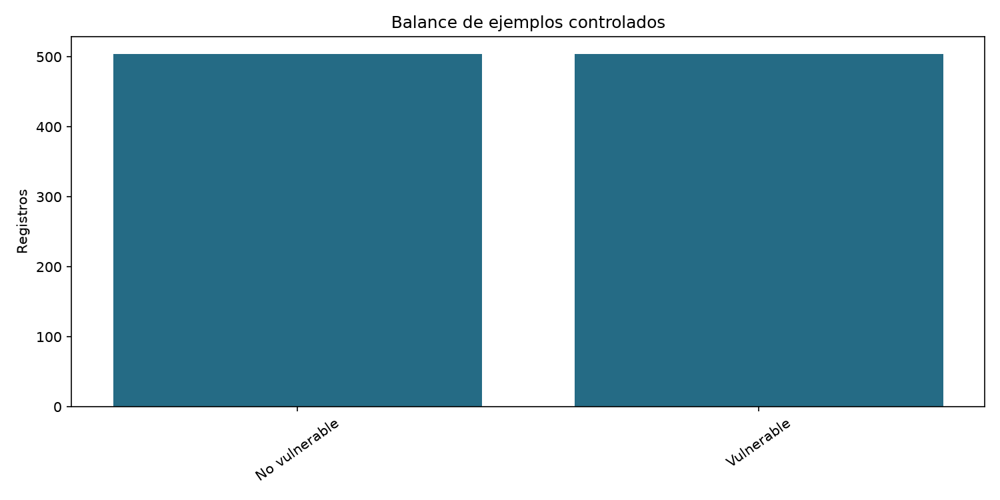
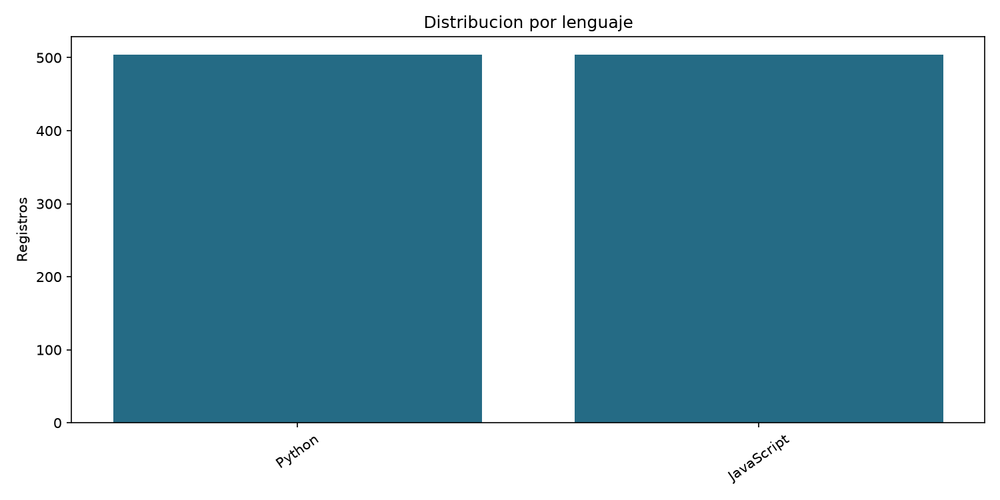
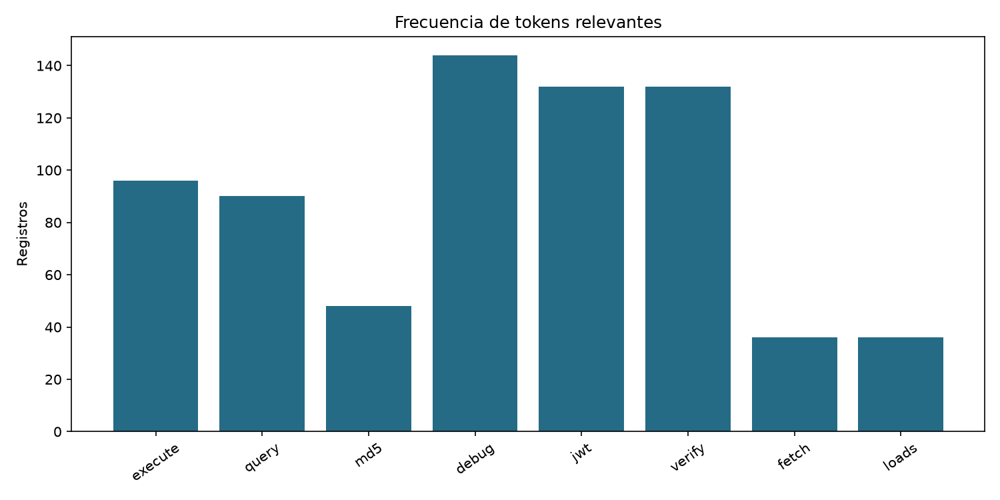
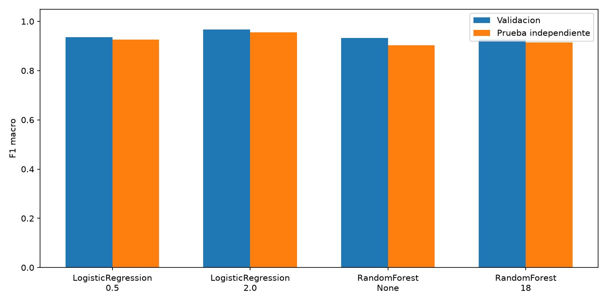
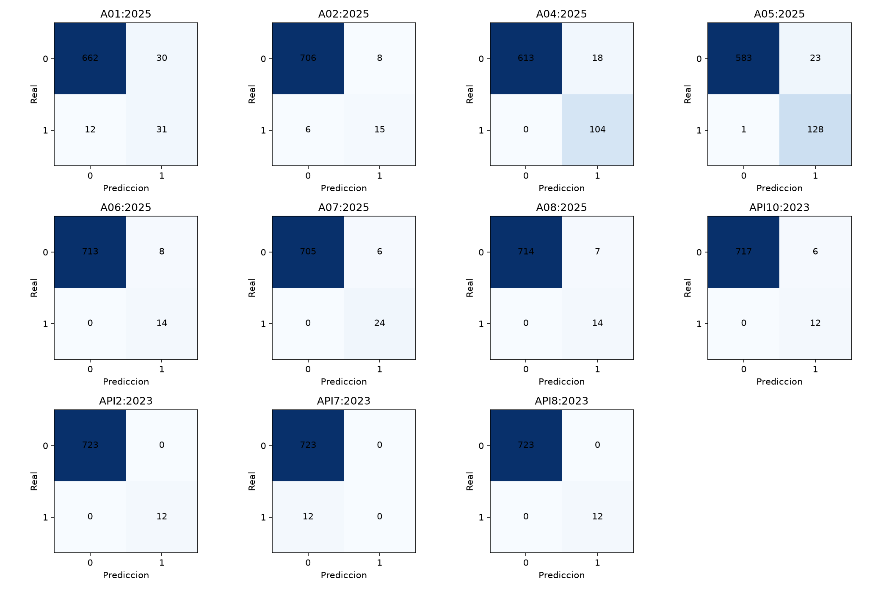

# VulnMiner: informe técnico

Universidad de las Fuerzas Armadas ESPE - Carrera de Ingeniería en Software

Desarrollo de Software Seguro | Laboratorio 1 | Docente: Prof. Geovanny Cudco

Informe técnico de implementación y experimentación. 24 de noviembre de 2026.

Autor: DavidPilaguano. Repositorio: DavidPilaguano-VulnMiner-SoftwareSeguro. Entrega de la actividad: 26 de noviembre de 2026.

Resultado principal: LogisticRegression, F1 macro de prueba 0.9556, con 1.008 fragmentos sintéticos y separación por familia. Este resultado no acredita generalización a producción.

## 1. Problema, objetivo y alcance

Los microservicios distribuyen código, interfaces y configuración entre componentes heterogéneos. La actividad exige aprender patrones de posibles vulnerabilidades y producir evidencias verificables desde un único comando ejecutado en la raíz del proyecto.

El objetivo es integrar las cinco fases SEMMA con un clasificador supervisado multietiqueta, contrastar dos algoritmos y exportar hallazgos OWASP Top 10:2025 y OWASP API Security Top 10:2023. La herramienta no utiliza LLM ni ejecuta el proyecto examinado.

Se soportan Python y JavaScript. TypeScript comparte el análisis léxico de JavaScript; no se afirma validación independiente de todas sus construcciones. Se leen configuraciones y manifiestos, con detección parcial centrada en depuración y TLS.

| Cobertura evaluada | Alcance |
| --- | --- |
| A01, A02, A04, A05, A07, A08 | Seis categorías de aplicaciones, limitadas a siete escenarios. |
| API2, API7, API8, API10 | Cuatro categorías API, bajo el contexto de los ejemplos. |
| A03, A06, A09, A10; API1, API3, API4, API5, API6, API9 | Catálogo presente; categorías expresamente no evaluadas. |

Los hallazgos son potenciales y requieren revisión. La ausencia de un hallazgo no equivale a seguridad. La confidencia del modelo se comunica como puntuación no calibrada y no determina por sí sola la severidad.

## 2. Sample: construcción y procedencia

Se identificaron OWASP Benchmark y NIST SARD como fuentes públicas posibles. Para esta entrega se eligieron exclusivamente casos controlados originales, permitidos por la consigna; no se importaron datos externos ni se atribuyeron resultados a sus suites.

Siete escenarios: SQL dinámica, criptografía débil, depuración activa, JWT sin firma verificada, SSRF, deserialización insegura y TLS sin validación. Cada escenario incluye dos lenguajes, seis familias, seis dominios y un par vulnerable/corregido. Son 84 grupos artificiales, no repositorios reales.

| Partición | Registros | Familias |
| --- | --- | --- |
| Entrenamiento | 672 | 0, 1, 2, 3 |
| Validación | 168 | 4 |
| Prueba | 168 | 5 |
| Total | 1008 | 504 vulnerables y 504 corregidos |

La proporción 66,7/16,7/16,7 conserva familias completas y se justifica frente al 70/15/15 recomendado. Nunca se reparten variantes de la misma familia entre particiones. No se encontraron duplicados exactos ni duplicados canónicos después de sustituir dominios y puertos conocidos; persiste similitud semántica entre patrones.

Se conservan id, procedencia, grupo, lenguaje, código, estado, etiquetas, CWE, partición y SHA-256. El diccionario y la tabla CWE-OWASP se entregan en data/. Las correspondencias API son contextuales, no equivalencias universales de CWE.

## 3. Explore: calidad y distribución

El dataset tiene 1008 filas, 504 corregidas y 504 vulnerables. Python y JavaScript aportan 504 filas cada uno. No hay faltantes en campos requeridos; CWE vacío y lista de etiquetas vacía son correctos para ejemplos mitigados.

A07 presenta doble soporte porque cubre autenticación JWT y validación del servidor TLS. Las frecuencias son multietiqueta: una fila puede sumar en ambas taxonomías. El balance artificial no representa la prevalencia real de vulnerabilidades.

## 4. Explore: lenguajes, patrones y sesgos

Longitud media: 74.9 caracteres; mínimo 30, máximo 162. Los ejemplos son cortos, con un defecto principal por fragmento. Ese diseño facilita el aprendizaje pero no representa flujos entre servicios, controles externos ni defectos combinados.

Las frecuencias de tokens describen cómo fueron construidos los ejemplos. No prueban vulnerabilidad por sí solas. El gráfico adicional desbalance.png y las tablas estadísticas se entregan en output/evaluation/.

## 5. Modify: preparación y características

La normalización elimina comentarios de línea y uniforma saltos de línea. Se preservan constantes relevantes, incluyendo true/false, nombres criptográficos y operadores SQL. Los datos se validan antes de entrenar; duplicados, etiquetas inconsistentes o mezcla de grupos provocan error.

Se unen dos representaciones TF-IDF: caracteres de longitud 3 a 5 y tokens/unigramas-bigramas. Los límites son 22.000 y 8.000 características respectivamente, min_df=2 y frecuencia sublineal. Solo code entra al clasificador; no se usan CWE, escenario, nombre de archivo ni proyecto como predictores.

| Partición | Dimensión de matriz |
| --- | --- |
| train | [672, 7884] |
| validation | [168, 7884] |
| test | [168, 7884] |

El vocabulario y los pesos IDF se ajustan exclusivamente en entrenamiento. Validación y prueba solo se transforman. Se conservan matrices dispersas NPZ, etiquetas NPY e identificadores de filas JSON. Las listas OWASP se codifican con MultiLabelBinarizer; un caso corregido es un vector de ceros.

La ponderación balanced reduce el efecto de etiquetas menos frecuentes; no se aplicó sobremuestreo. Las variantes de identificadores permanecen en su familia. Los metadatos del pipeline y las versiones se incluyen junto al modelo.

## 6. Model: comparación experimental

Se comparó regresión logística One-vs-Rest (C=0.5 y 2.0, class_weight=balanced, max_iter=1500) con Random Forest multisalida (160 árboles, profundidad sin límite o 18, class_weight=balanced). Semilla 42. Los umbrales 0.30, 0.40, 0.50 y 0.60 se ajustaron con validación.

| Modelo / parámetro | Umbral | F1 macro validación | F1 macro prueba |
| --- | --- | --- | --- |
| LogisticRegression / 0.5 | 0.4 | 0.9356 | 0.9267 |
| LogisticRegression / 2.0 | 0.4 | 0.9667 | 0.9556 |
| RandomForest / None | 0.5 | 0.9333 | 0.9029 |
| RandomForest / 18 | 0.5 | 0.9253 | 0.9140 |

Se eligió LogisticRegression, parámetro 2.0, umbral 0.4, usando exclusivamente F1 macro de validación. En empate se prefiere el modelo lineal por simplicidad. Después se evaluaron las configuraciones congeladas sobre prueba; sus métricas no seleccionaron el modelo. No se readaptó el vocabulario con validación ni prueba.

## 7. Assess: métricas y errores

| Métrica en prueba | Valor |
| --- | --- |
| Precision micro | 0.8800 |
| Recall micro | 1.0000 |
| F1 micro | 0.9362 |
| F1 macro | 0.9556 |
| Coincidencia exacta de etiquetas | 0.8929 |

| Categoría | Precision | Recall | F1 | Soporte |
| --- | --- | --- | --- | --- |
| A01:2025 | 1.000 | 1.000 | 1.000 | 12 |
| A02:2025 | 1.000 | 1.000 | 1.000 | 12 |
| A04:2025 | 1.000 | 1.000 | 1.000 | 12 |
| A05:2025 | 0.500 | 1.000 | 0.667 | 12 |
| A07:2025 | 0.800 | 1.000 | 0.889 | 24 |
| A08:2025 | 1.000 | 1.000 | 1.000 | 12 |
| API10:2023 | 1.000 | 1.000 | 1.000 | 12 |
| API2:2023 | 1.000 | 1.000 | 1.000 | 12 |
| API7:2023 | 1.000 | 1.000 | 1.000 | 12 |
| API8:2023 | 1.000 | 1.000 | 1.000 | 12 |

18 registros de prueba tienen al menos un error. Falsas etiquetas positivas: {'A05:2025': 12, 'A07:2025': 6}. Falsas etiquetas negativas: {}. El archivo errors.json conserva el fragmento y las etiquetas erróneas. El recall alto no elimina el riesgo: los casos sintéticos son estrechos y los errores recaen también en controles que el modelo no reconoce como suficientes.

## 8. Assess: matrices y generalización

Cada matriz es binaria por etiqueta: filas reales y columnas predichas; orden 0 (ausencia), 1 (presencia). Es una evaluación multietiqueta, no una matriz multiclase exclusiva.

Se evaluó el flujo completo sobre dos proyectos de fixtures ajenos al entrenamiento, con servicios Python y JavaScript/TypeScript. Cada uno incluye siete casos vulnerables y siete corregidos. Los nombres y estructuras no son filas del CSV. Se utilizaron para corregir falsos positivos del extractor y después como pruebas de regresión; no son una validación ciega.

| Proyecto | TP/FP/FN/TN | Precision | Recall | F1 |
| --- | --- | --- | --- | --- |
| tienda-demo | 7/0/0/7 | 1.000 | 1.000 | 1.000 |
| logistica-demo | 7/0/0/7 | 1.000 | 1.000 | 1.000 |

La CLI detecta seis categorías generales y cuatro de API en las fixtures. El rendimiento perfecto sobre esos pocos pares es un control funcional y no una estimación de producción. La evaluación del proyecto desconocido del docente sigue pendiente de recibir dicho proyecto y su verdad de referencia.

## 9. Arquitectura y herramienta CLI

Módulos: catalog define las veinte categorías y los escenarios; features implementa las transformaciones; scanner descubre servicios y extrae contexto; reporting exporta JSON/HTML; cli valida argumentos y coordina la ejecución. scripts contiene generación, entrenamiento, evaluación y construcción de entregables.

Descubrimiento: se buscan manifiestos de Python/Node/Java, Dockerfile y contextos build de Compose dentro de la raíz. El servicio más cercano recibe el hallazgo. Los archivos de configuración de la raíz se informan separadamente cuando no hay servicio propietario. Reconocer un pom.xml no implica analizar Java: el análisis de código Java no está soportado.

El extractor localiza operaciones sensibles y obtiene ventanas de contexto sin cruzar líneas vacías. El pipeline aprendido predice etiquetas; se exige umbral y evidencia compatible. Si hay un patrón sensible sin clasificación respaldada se emite pendiente de revisión. Las reglas no asignan etiquetas cuando el clasificador devuelve ceros, lo que se verifica mediante una prueba.

Cada hallazgo incluye id estable, servicio, archivo, línea, lenguaje, descripción, evidencia/contexto, ambas listas OWASP, CWE cuando procede, puntuación general y por etiqueta, severidad estimada con justificación, recomendación, estado y confirmed=false. El HTML permite filtrar por servicio y muestra categorías no evaluadas.

La herramienta omite carpetas de dependencias y compilación, enlaces simbólicos y archivos mayores a 1 MB; registra omisiones. El HTML escapa evidencia para impedir que el contenido analizado se interprete como marcado. No se ejecuta código del proyecto ni se cargan modelos suministrados por el usuario.

## 10. Instalación, comprobaciones y demostración

Instalar con python -m pip install -e ".[lab]" en un entorno virtual. Ejecutar desde la raíz del proyecto: vulnminer scan . --standards owasp2025,api2023 --format json,html --output ./reportes. También funciona python -m vulnminer scan . cuando el ejecutable no está en PATH.

La versión de scikit-learn se fija en 1.8.0, coincidente con el modelo entregado. Durante la preparación se corrigió una incompatibilidad de versiones y se repitió el entrenamiento. metadata.json registra Python, numpy y scikit-learn. El paquete incluye model.joblib: no es necesario ejecutar entrenamiento para cada escaneo.

Se ejecutaron 10 pruebas automatizadas: cobertura y líneas, pares seguros y metadatos, catálogo, filtro de estándares, abstención al retirar el aprendizaje, escape HTML y esquema JSON, exclusiones y patrones desconocidos, YAML, errores/códigos CLI e independencia del dataset. Los cinco notebooks se ejecutan de principio a fin.

Los reportes de ejemplo y las matrices se entregan como evidencia reproducible. Para regenerar: scripts/reproduce.ps1 -Install. El guion docs/demostracion.md explica cómo presentar SEMMA, comparar modelos y ejecutar el proyecto del docente cuando esté disponible.

Limitaciones: extracción léxica, ventanas cortas, ausencia de flujo interprocedimental, sin análisis dinámico, sin base CVE, sin inventario completo, sin verificación de autorización y sin calibración de confianza. Las mitigaciones de los pares seguros suponen auxiliares correctamente implementados. Los reportes pueden incluir información sensible del código fuente.

## 11. Conclusiones y referencias

La experiencia muestra que un modelo supervisado con TF-IDF puede reconocer patrones controlados y asignar etiquetas de ambos estándares dentro de una CLI reproducible. La regresión logística superó a Random Forest en el criterio de validación del experimento. La herramienta satisface la cobertura mínima mediante seis categorías generales y cuatro de API.

La pregunta orientadora solo puede responderse dentro del alcance medido: el modelo logra F1 macro de prueba 0.9556 sobre familias sintéticas reservadas, con errores documentados. No hay base para extrapolar esa cifra a repositorios reales. La evaluación externa y la revisión humana son indispensables para concluir sobre utilidad operativa.

Mejoras propuestas: incorporar ejemplos públicos con licencias y procedencia verificadas; reservar repositorios reales para un ensayo ciego; usar AST y flujo de datos; incorporar controles entre archivos; calibrar puntuaciones y estudiar curvas precisión-recall; ampliar categorías solo después de disponer de datos y evaluación suficientes.

Consigna del laboratorio: Modelo_mineria_datos.pdf, ESPE, 19 de noviembre de 2026.

OWASP Top 10:2025: https://top10.owasp.org/2025/

OWASP API Security Top 10:2023: https://api-security.owasp.org/editions/2023/en/0x11-t10/

OWASP Benchmark, fuente identificada no incorporada: https://owasp.org/www-project-benchmark/

NIST SARD, fuente identificada no incorporada: https://samate.nist.gov/SARD/

Correspondencias y fuentes por escenario: docs/fuentes.md y data/cwe_owasp.csv

Versiones y experimento reproducible: output/evaluation/metrics.json y vulnminer/artifacts/metadata.json
